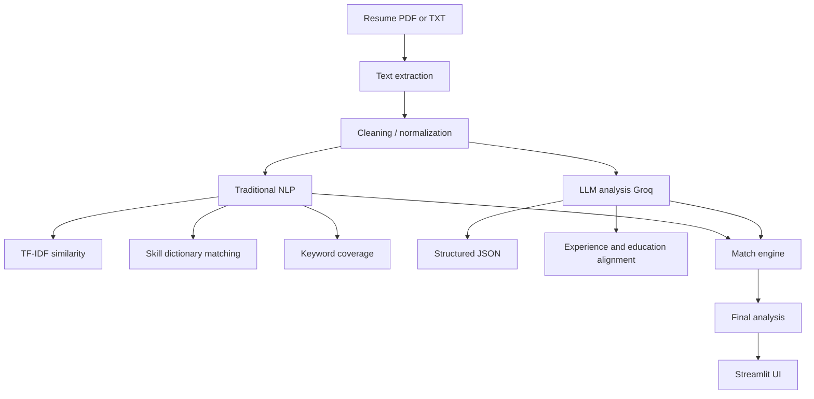

# AI Resume Analyzer & Job Match System

Academic NLP project that matches a resume to a job description using **traditional NLP** and a **Groq LLM**, then combines those signals with a configurable scoring engine.

## 1. Project overview

The application extracts resume text (PDF or TXT), measures overlap with a job description using TF-IDF, skill dictionaries, and keyword coverage, then asks a Groq GPT-OSS model for structured contextual analysis. A `MatchEngine` computes the **final match score programmatically**. The LLM score is displayed separately and is never copied as the final result.

## 2. Problem statement

Applicant tracking systems often rely on brittle keyword overlap, while chat-only LLM tools can hallucinate skills and hide how a score was produced. This project demonstrates both measurable classical NLP features and constrained LLM reasoning, with explicit handling when the LLM is unavailable.

## 3. Features

- PDF (PyMuPDF) and TXT resume upload, plus paste and demo mode
- Resume section extraction (education, experience, skills, projects, certifications)
- TF-IDF cosine similarity and job-keyword coverage
- Configurable skill dictionary with alias normalization
- Groq structured JSON analysis (skills, experience, education, strengths, weaknesses, recommendations)
- Weighted final score from `config.yaml`
- Streamlit dashboard with Plotly charts
- JSON and CSV export
- Traditional NLP continues if `GROQ_API_KEY` is missing

## 4. Architecture



## 5. NLP techniques used

- Unicode normalization and whitespace cleanup
- `TfidfVectorizer` (unigrams and bigrams, English stop words)
- Cosine similarity between resume and job description vectors
- Top-weighted job terms as keywords; coverage is the fraction of those terms also present in the resume vector
- Rule-based section headers
- Lightweight entity cues (emails, years, degree strings)
- Skill matching from `src/data/skills.json` (no external skills API)

## 6. LLM integration

- Provider: Groq
- Environment variable: `GROQ_API_KEY` loaded with `python-dotenv` from **project-root `.env` only**
- Client is created at analysis time, not at import time
- Structured outputs use JSON Schema via the Groq chat completions API, with a `json_object` fallback if schema mode is rejected
- Responses are parsed with Pydantic (`LLMStructuredOutput`)
- One retry on malformed JSON, then primary → fallback model
- Failures return `LLMMatchResult.available = False` with an error category such as `missing_api_key`, `invalid_api_key`, `rate_limit`, `network_failure`, `model_unavailable`, or `malformed_response`

## 7. Prompt engineering

Templates live in `prompts/resume_prompts.py`:

- `RESUME_JOB_MATCH_PROMPT`
- `SKILL_GAP_PROMPT`
- `RESUME_IMPROVEMENT_PROMPT`

Each prompt defines role, inputs, JSON schema, bans invented experience, and states: **do not assume that the candidate has a skill merely because related terminology appears.** Pandas is not Spark.

## 8. Model used

Configured in `config.yaml` (not hard-coded in Python):

- Primary: `openai/gpt-oss-120b`
- Fallback: `openai/gpt-oss-20b`

Deprecated Llama Groq IDs are not used.

## 9. Installation

```bash
cd resume-analyzer
python -m venv .venv
.venv\Scripts\activate
pip install -r requirements.txt
```

## 10. .env setup

Copy `.env.example` to `.env` in the project root:

```
GROQ_API_KEY=your_groq_api_key_here
```

Do not place `.env` under `src/`, `tests/`, or `prompts/`. `.env` is gitignored.

## 11. Running the project

```bash
python run.py
```

Equivalent:

```bash
streamlit run src/app.py
```

## 12. Example input

Demo mode loads:

- `sample_data/sample_resume.txt` — fictional candidate with Python, SQL, ML, pandas, scikit-learn, FastAPI, Git, REST APIs, bachelor’s degree, two internships
- `sample_data/sample_job_description.txt` — junior data scientist / analyst requiring Python, SQL, pandas, ML, Power BI, AWS, Docker, statistics

## 13. Example output

Typical traditional NLP on the samples:

- Matched skills: Python, SQL, Pandas, Machine Learning (and related dictionary hits such as Statistics if present in coursework)
- Missing skills: Power BI, AWS, Docker
- Non-zero TF-IDF similarity and keyword coverage

LLM (when the API key works) adds partial skills, experience/education alignment, a candidate summary, and recommendations that must not invent Spark/AWS experience.

Scores are shown as:

- Traditional NLP Score
- LLM Assessment (or **LLM unavailable**)
- Final Match Score (weighted blend)

## 14. Technical design

Shared Pydantic models in `src/models/schemas.py`:

- `ResumeDocument`, `JobDescription`, `ResumeSection`, `SkillMatch`
- `TraditionalNLPResult`, `LLMStructuredOutput`, `LLMMatchResult`
- `MatchResult`, `AnalysisError`, `AnalysisOutcome`

Call conventions:

- Extraction: `(text, error)`
- Cache: `get()`, `put()`, `clear()`, `stats()`
- NLP: `TraditionalNLPAnalyzer.analyze(resume, job) -> TraditionalNLPResult`
- LLM: `LLMAnalyzer.analyze(resume, job) -> LLMMatchResult`
- Engine: `MatchEngine.combine(traditional, llm) -> MatchResult`
- Pipeline: `run_full_analysis(...) -> AnalysisOutcome`

Default weights (`config.yaml`):

- TF-IDF 20%, keyword coverage 15%, LLM skill alignment 30%, experience 20%, education 5%, explicit skill ratio 10%

If the LLM is down, only TF-IDF, keyword coverage, and explicit skill ratio are used (renormalized).

## 15. Error handling

| Situation | Behavior |
| --- | --- |
| Missing API key | NLP runs; UI shows LLM unavailable |
| Invalid key / rate limit / network / missing model | Same; category shown |
| Malformed LLM JSON | Retry once per model, then structured error |
| Empty resume/JD | No fake scores |
| Unreadable PDF | Message asking for a text-based PDF or paste |
| Huge resume | Rejected via `analysis.max_text_length` |
| Missing config fields | Startup error, no crash loop |

API keys are never printed.

## 16. Testing

```bash
python -m compileall src prompts
python -m pytest -q
```

Coverage includes PDF/TXT extraction, cleaning, skill aliases, TF-IDF, match weights, Pydantic schema, malformed LLM output, missing API key, cache `get`/`put`, and empty inputs. Groq is mocked; tests do not call the live API.

## 17. Limitations

- No OCR for scanned PDFs
- Skill list is a static dictionary, not an exhaustive labor-market graph
- Section detection is header-based and can miss unconventional resumes
- LLM quality depends on Groq availability and prompt adherence
- Partial skills from the LLM are contextual; traditional NLP only reports explicit dictionary matches

## 18. Future improvements

- Layout-aware PDF parsing
- Optional local embeddings for semantic similarity
- Human-in-the-loop skill dictionary editing in the UI
- Batch matching against multiple job descriptions
